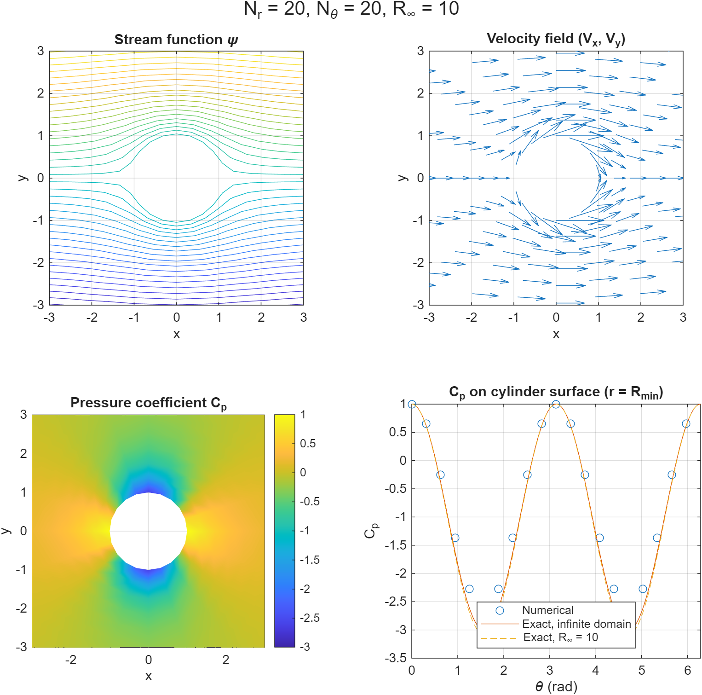
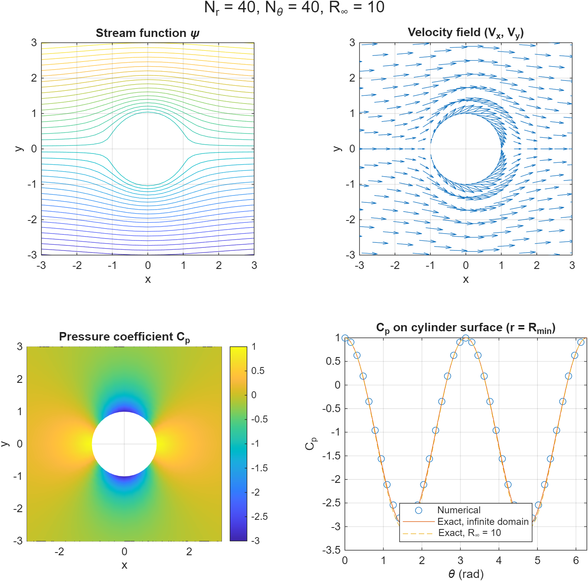
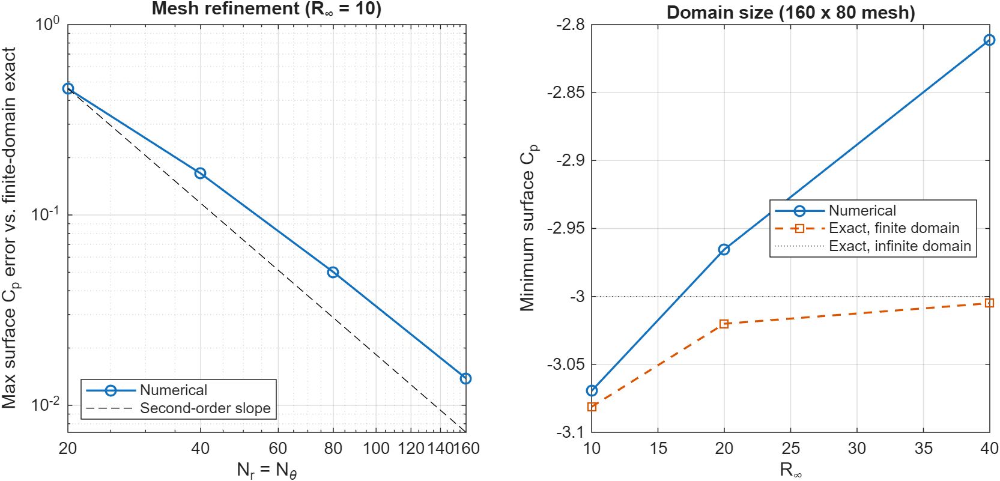

# Potential Flow Over a Circular Cylinder: Finite-Difference Solver

A MATLAB solver for the stream function of steady, incompressible, irrotational flow past a circular cylinder. The solver uses second-order finite differences on a stretched polar mesh and a sparse direct solve. From the stream function I recover the velocity and pressure fields and the pressure forces on the cylinder, then use the exact solution to separate **discretization error** from **domain-truncation error**.

## Problem

For steady, incompressible, inviscid, irrotational flow, the stream function $\psi$ satisfies Laplace's equation:

$$\nabla^2\psi = \frac{\partial^2\psi}{\partial r^2} + \frac{1}{r}\frac{\partial\psi}{\partial r} + \frac{1}{r^2}\frac{\partial^2\psi}{\partial\theta^2} = 0$$

on the annulus $R_{min} \le r \le R_\infty$, with a cylinder of radius $R_{min}$ in a uniform stream $U_\infty$. Lengths and velocities are normalized so that $R_{min} = 1$ and $U_\infty = 1$.

**Boundary conditions**

- Cylinder surface ($r = R_{min}$): $\psi = C_0$
- Outer boundary ($r = R_\infty$): $\psi = U_\infty R_\infty \sin\theta + C_\infty$
- Periodic in $\theta$

All results below use $C_0 = C_\infty = 0$ (no circulation).

**Exact solutions**

- Infinite domain: $\psi = U_\infty (r - R_{min}^2/r)\sin\theta$, giving surface $C_p = 1 - 4\sin^2\theta$ (minimum $-3$).
- Finite annulus (the problem actually solved): $\psi = (Ar + B/r)\sin\theta$ with $A = U_\infty R_\infty^2/(R_\infty^2 - R_{min}^2)$ and $B = -AR_{min}^2$. The surface pressure coefficient is $C_p = 1 - 4(A/U_\infty)^2\sin^2\theta$.

The finite-domain solution approaches the infinite-domain one only as $R_\infty \to \infty$. This distinction matters for interpreting the results.

## Method

**Mesh.** The mesh is uniform in $\theta$ and exponentially stretched in $r$ through a uniform coordinate $s \in [0,1]$:

$$r(s) = R_{min} + (R_\infty - R_{min})\,\frac{e^{\alpha s} - 1}{e^{\alpha} - 1}$$

Points cluster near the cylinder. I used $\alpha = 0.5$ for every case, chosen from a sweep of $\alpha$ (`study_radial_stretching.m`).

**Discretization.** The Laplacian is rewritten in $(s, \theta)$:

$$\frac{1}{r_s^2}\psi_{ss} + \left[\frac{1}{r\,r_s} - \frac{r_{ss}}{r_s^3}\right]\psi_s + \frac{1}{r^2}\psi_{\theta\theta} = 0$$

Second-order central differences give a five-point stencil at each interior node, with periodic wrap in $\theta$. The resulting sparse linear system $D\vec\psi = \vec f$ is solved with MATLAB's backslash.

**Post-processing**

- Velocity: $V_r = \frac{1}{r}\psi_\theta$ and $V_\theta = -\psi_r = -\psi_s/r_s$. The $\theta$-derivative is a periodic central difference. The $s$-derivative is central in the interior and a second-order one-sided difference at the two radial boundaries.
- Pressure coefficient from Bernoulli's equation: $C_p = 1 - (V_r^2 + V_\theta^2)/U_\infty^2$.
- Pressure force on the cylinder per unit span: $\vec F = -\oint p\,\hat n\,dA$ with $p - p_\infty = \tfrac12\rho U_\infty^2 C_p$ and $\rho = 1$. I report the y-force on the upper half ($0 \le \theta \le \pi$), the x-force on the left half ($\pi/2 \le \theta \le 3\pi/2$), and both components over the full cylinder.

## Cases

| Study | $N_r$ | $N_\theta$ | $R_\infty$ |
|---|---|---|---|
| Mesh refinement | 20, 40, 80, 160 | 20, 40, 80, 160 | 10 |
| Domain size | 160 | 80 | 10, 20, 40 |

## Results

<p align="center">
  
  
  
</p>

*Stream function, velocity vectors, $C_p$ field, and surface $C_p$ for three meshes.*

| $N_r$ | $N_\theta$ | $R_\infty$ | max \|ψ − ψ_exact\| | $C_{p,min}$ | max \|$C_p$ − $C_{p,exact}$\| (finite domain) | $F_y$ upper half | $F_x$ left half |
|---|---|---|---|---|---|---|---|
| 20 | 20 | 10 | 9.87e-3 | -2.620 | 0.462 | 1.422 | -0.185 |
| 40 | 40 | 10 | 2.48e-3 | -2.916 | 0.165 | 1.613 | -0.299 |
| 80 | 80 | 10 | 6.23e-4 | -3.031 | 0.0501 | 1.688 | -0.342 |
| 160 | 160 | 10 | 1.56e-4 | -3.067 | 0.0139 | 1.712 | -0.355 |
| 160 | 80 | 10 | 7.27e-4 | -3.070 | 0.0117 | 1.714 | -0.355 |
| 160 | 80 | 20 | 1.65e-3 | -2.965 | 0.0547 | 1.644 | -0.320 |
| 160 | 80 | 40 | 3.46e-3 | -2.811 | 0.194 | 1.541 | -0.269 |

Reference values from the closed-form solution:

| $R_\infty$ | $C_{p,min}$ | $F_y$ upper half | $F_x$ left half |
|---|---|---|---|
| 10 | -3.081 | 1.721 | -0.360 |
| 20 | -3.020 | 1.680 | -0.340 |
| 40 | -3.005 | 1.670 | -0.335 |
| ∞ | -3 | 5/3 ≈ 1.667 | -1/3 ≈ -0.333 |

<p align="center">
  
</p>

### Findings

- **The solver is second-order accurate.** The stream function error drops by about 4× each time the mesh is doubled (9.9e-3 → 2.5e-3 → 6.2e-4 → 1.6e-4). The surface $C_p$ error converges more slowly at first (successive ratios of 2.8, 3.3, 3.6) and approaches the second-order rate.
- **A finite domain changes the answer being converged to.** At $R_\infty = 10$ the exact minimum $C_p$ is -3.081, not -3. The numerical $C_{p,min}$ converges toward -3.08 and passes through -3 between $N = 40$ and $N = 80$. Error measured against the infinite-domain value is therefore non-monotonic (0.380, 0.084, 0.031, 0.067) and is not a reliable convergence measure. Measuring against the finite-domain exact solution isolates the discretization error.
- **A larger domain at a fixed mesh is not automatically better.** The domain-truncation bias in $C_{p,min}$ shrinks (-3.081 → -3.020 → -3.005), but with the same 160 × 80 mesh and fixed $\alpha$, the cells next to the cylinder get larger (first radial cell ≈ 0.044, 0.092, 0.19 for $R_\infty$ = 10, 20, 40). The surface $C_p$ error grows accordingly (0.012, 0.055, 0.194). Matching the infinite-domain answer needs both a large domain and fine near-wall resolution; none of the tested combinations achieves both.
- **Full-cylinder forces vanish.** The total x- and y-forces are between about 10⁻¹⁵ and 10⁻¹³ in every case, consistent with d'Alembert's paradox for steady inviscid flow. The nonzero half-cylinder values are real pressure integrals that cancel over the whole body, and they converge toward the closed-form values above.
- **Azimuthal resolution is not the limiting factor for surface $C_p$.** Going from 160 × 80 to 160 × 160 at $R_\infty = 10$ reduced the stream function error by about 4.7× but did not reduce the maximum surface $C_p$ error (0.0117 → 0.0139). This suggests the wall-adjacent one-sided radial derivative dominates the surface error, but I have not tested that directly.

## Limitations

- The same $\alpha = 0.5$ is used for all domain sizes. Re-tuning $\alpha$ or $N_r$ for each $R_\infty$ would likely improve the large-domain cases.
- The model is inviscid, steady, and has no circulation. The exact-solution comparisons assume $C_0 = C_\infty = 0$.
- Error metrics are maximum nodal errors on the surface, not integrated errors.
- Case selection is a small study (7 runs), and the Nθ finding above is unexplained.

## How to run

Requires MATLAB R2020a or newer (uses `exportgraphics`). From this folder:

```matlab
run_potential_flow            % mesh + domain studies; writes figures and CSV to ./results
study_radial_stretching       % optional: sweep of the stretching parameter alpha
```

## Files

| File | Purpose |
|---|---|
| `run_potential_flow.m` | Driver: runs all cases, prints summary table, saves figures |
| `solve_laplace_cylinder.m` | Assembles and solves the sparse system for $\psi$ |
| `radial_mesh.m` | Stretched radial grid and its metric terms |
| `compute_velocity_field.m` | Velocity components from $\psi$ |
| `compute_surface_loads.m` | Pressure force integrals on the cylinder |
| `exact_stream_function.m` | Finite-domain analytical solution |
| `plot_case_summary.m` | Four-panel figure for one case |
| `study_radial_stretching.m` | Sweep of $\alpha$ against mesh smoothness and error |
