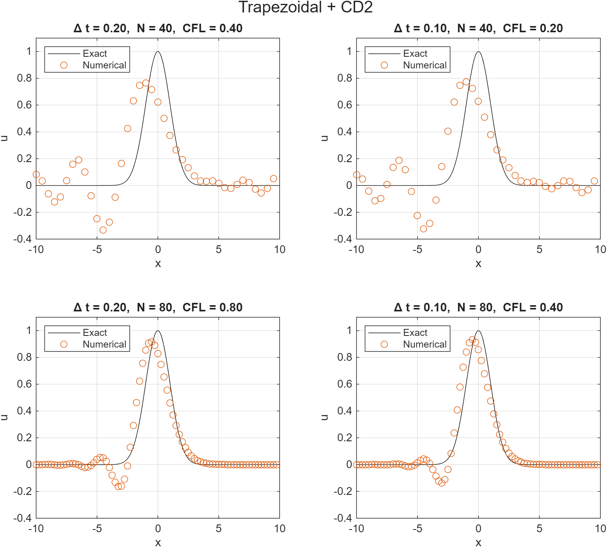
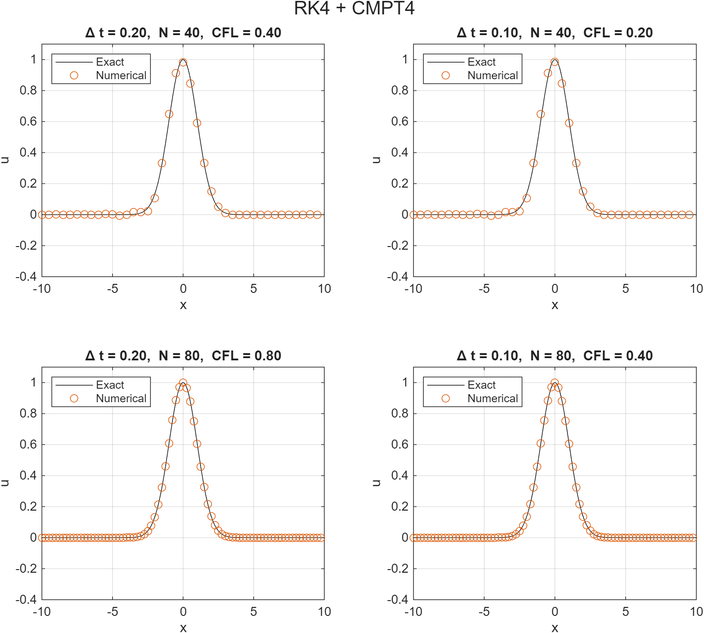
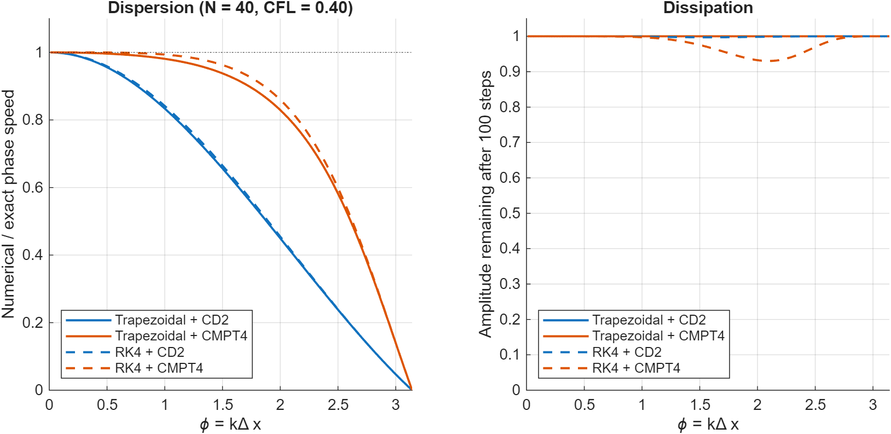

# Linear Advection: Time and Space Discretization Schemes

A MATLAB study of how the choice of time integrator and spatial derivative scheme affects the accuracy of the 1D linear advection equation. Two time schemes (Trapezoidal, RK4) and two spatial schemes (second-order central, fourth-order compact) are paired four ways and tested three ways: error at several grid and time-step settings, observed order of accuracy under grid refinement, and a Fourier analysis of each scheme's dispersion and dissipation.

## Problem

```math
\frac{\partial u}{\partial t} + a\frac{\partial u}{\partial x} = 0, \qquad x \in [-10, 10] \text{ (periodic)}, \qquad u(x,0) = e^{-x^2/2}
```

with $`a = 1`$ and final time $`t = 20`$. The exact solution is the initial profile translated by $`at`$ and wrapped around the periodic domain. Because the domain length (20) equals $`a\,t_{\text{end}}`$, the pulse makes exactly one lap and **the exact solution at $`t = 20`$ equals the initial condition**. Any visible shift or ripple is therefore numerical error.

## Methods

**Spatial schemes.** Each scheme is applied as a periodic matrix $`D`$ with $`Du \approx \Delta x \, \partial u/\partial x`$.

*CD2*, second-order central difference:

```math
u'_i \approx \frac{u_{i+1} - u_{i-1}}{2\Delta x}
```

*CMPT4*, fourth-order tridiagonal compact scheme, where the derivative is defined implicitly (a periodic tridiagonal system is solved for $`u'`$):

```math
\frac{1}{4}u'_{i-1} + u'_i + \frac{1}{4}u'_{i+1} = \frac{3}{4\Delta x}\left(u_{i+1} - u_{i-1}\right)
```

**Time schemes.** With $`C = a\,\Delta t/\Delta x`$ (the CFL number), each scheme reduces to a one-step matrix because the problem is linear with constant coefficients.

*Trapezoidal* (implicit, second-order):

```math
\left(I + \frac{C}{2}D\right)u^{n+1} = \left(I - \frac{C}{2}D\right)u^n
```

*RK4* (explicit, fourth-order). For a linear system, classical RK4 is exactly this Taylor polynomial:

```math
u^{n+1} = \sum_{m=0}^{4} \frac{(-CD)^m}{m!}\, u^n
```

**Fourier analysis.** For a mode $`e^{ikx}`$ with $`\phi = k\Delta x`$, the spatial operators have symbols $`i\sin\phi`$ (CD2) and $`i\,\frac{1.5\sin\phi}{1 + 0.5\cos\phi}`$ (CMPT4). Each time scheme turns this into a per-step amplification factor $`G`$. The numerical phase speed relative to the exact speed is $`-\arg(G)/(C\phi)`$, and $`|G|^n`$ is the amplitude left after $`n`$ steps.

## Studies

1. **Scheme comparison** (`run_advection.m`): all four pairings at $`(\Delta t, N) = (0.2, 40), (0.1, 40), (0.2, 80), (0.1, 80)`$, with L2 and maximum nodal error against the exact solution.
2. **Order of accuracy** (`study_convergence.m`): $`N = 40, 80, 160, 320, 640`$ at fixed CFL = 0.4, so $`\Delta t`$ shrinks with $`\Delta x`$. The observed order is $`\log_2(E_N / E_{2N})`$.
3. **Dispersion and dissipation** (`plot_scheme_spectra.m`): phase speed and amplitude for each pairing at $`N = 40`$, $`\Delta t = 0.2`$ (CFL = 0.4, 100 steps).

Errors are discrete L2 norms, $`\sqrt{\Delta x \sum_i e_i^2}`$, at the grid nodes. For scale, the exact solution has an L2 norm of about 1.33.

## Results

<p align="center">
  
  
</p>

*Left: Trapezoidal + CD2 (largest errors). Right: RK4 + CMPT4 (smallest errors). Each figure shows the four $(\Delta t, N)$ settings; the other two pairings are in `results/`.*

### Error at the four settings

| Time scheme | Space scheme | Δt | N | CFL | L2 error | Max error |
|---|---|---|---|---|---|---|
| Trapezoidal | CD2 | 0.20 | 40 | 0.4 | 0.833 | 0.496 |
| Trapezoidal | CD2 | 0.10 | 40 | 0.2 | 0.814 | 0.487 |
| Trapezoidal | CD2 | 0.20 | 80 | 0.8 | 0.413 | 0.300 |
| Trapezoidal | CD2 | 0.10 | 80 | 0.4 | 0.356 | 0.269 |
| Trapezoidal | CMPT4 | 0.20 | 40 | 0.4 | 0.159 | 0.126 |
| Trapezoidal | CMPT4 | 0.10 | 40 | 0.2 | 0.0812 | 0.0648 |
| Trapezoidal | CMPT4 | 0.20 | 80 | 0.8 | 0.120 | 0.0953 |
| Trapezoidal | CMPT4 | 0.10 | 80 | 0.4 | 0.0330 | 0.0260 |
| RK4 | CD2 | 0.20 | 40 | 0.4 | 0.808 | 0.483 |
| RK4 | CD2 | 0.10 | 40 | 0.2 | 0.808 | 0.483 |
| RK4 | CD2 | 0.20 | 80 | 0.8 | 0.336 | 0.256 |
| RK4 | CD2 | 0.10 | 80 | 0.4 | 0.336 | 0.256 |
| RK4 | CMPT4 | 0.20 | 40 | 0.4 | 0.0570 | 0.0432 |
| RK4 | CMPT4 | 0.10 | 40 | 0.2 | 0.0558 | 0.0421 |
| RK4 | CMPT4 | 0.20 | 80 | 0.8 | 0.00507 | 0.00408 |
| RK4 | CMPT4 | 0.10 | 80 | 0.4 | 0.00339 | 0.00265 |

### Order of accuracy (CFL = 0.4)

| N | Trap + CD2 | Trap + CMPT4 | RK4 + CD2 | RK4 + CMPT4 |
|---|---|---|---|---|
| 40 | 8.33e-1 | 1.59e-1 | 8.08e-1 | 5.70e-2 |
| 80 | 3.56e-1 | 3.30e-2 | 3.36e-1 | 3.39e-3 |
| 160 | 1.01e-1 | 7.76e-3 | 9.38e-2 | 2.06e-4 |
| 320 | 2.56e-2 | 1.91e-3 | 2.37e-2 | 1.28e-5 |
| 640 | 6.41e-3 | 4.75e-4 | 5.93e-3 | 7.97e-7 |

| Grid pair | Trap + CD2 | Trap + CMPT4 | RK4 + CD2 | RK4 + CMPT4 |
|---|---|---|---|---|
| 40 → 80 | 1.22 | 2.27 | 1.27 | 4.07 |
| 80 → 160 | 1.82 | 2.09 | 1.84 | 4.04 |
| 160 → 320 | 1.98 | 2.02 | 1.98 | 4.01 |
| 320 → 640 | 2.00 | 2.01 | 2.00 | 4.00 |

<p align="center">
  
</p>

### Dispersion and dissipation

<p align="center">
  
</p>

## Findings

- **The observed orders match the schemes.** Three pairings converge at second order and RK4 + CMPT4 at fourth order (2.00, 2.01, 2.00, and 4.00 at the finest grid pair). The coarse-grid orders are lower for CD2 (1.2-1.3) because those meshes are too coarse for the asymptotic rate to apply.
- **The overall order is set by the weaker component.** Trapezoidal + CMPT4 converges at second order even though its spatial scheme is fourth-order, because the second-order time stepping dominates the error. RK4 + CD2 is also second-order, limited by the spatial scheme. Only RK4 + CMPT4 uses fourth-order methods in both.
- **Which error dominates depends on the setting.** For RK4 + CD2 at $N = 40$, halving $\Delta t$ leaves the error unchanged to five digits (0.80752 vs. 0.80751), so the error is spatial. For Trapezoidal + CMPT4 at $N = 80$, halving $\Delta t$ cuts the error by a factor of about 3.6 (0.120 to 0.0330), so the error is temporal. At $N = 40$, the same halving only reduces the error by about 2×, because the spatial error (about 0.056, from RK4 + CMPT4) becomes comparable.
- **The errors are dominated by dispersion, not dissipation.** Trapezoidal + CD2 has no numerical dissipation ($|G| = 1$ exactly for these schemes), yet its error (0.83) is nearly the same as RK4 + CD2 (0.81). With CD2, short waves travel slower than the exact speed (about 84% at $\phi = 1$), so they fall behind the main pulse. This shows up as the trailing ripples behind the pulse and the visible lag of its peak.
- **Dissipation only matters for RK4 + CMPT4, and only at high wavenumber.** The amplitude dips to about 0.93 after 100 steps near $\phi \approx 2.1$, where the Gaussian's spectrum ($e^{-k^2/2}$) has very little content. Trapezoidal schemes show no damping.
- **Trapezoidal time stepping adds its own phase lag.** For CMPT4, where the spatial error is small, the Trapezoidal curve sits visibly below the RK4 curve at mid-to-high $\phi$.
- **The compact scheme is much more accurate per grid point.** RK4 + CMPT4 with 80 points (L2 error 3.4e-3) beats RK4 + CD2 with 640 points (5.9e-3). This is a statement about grid points only; the compact scheme costs more per point because the derivative is defined implicitly.

## Limitations

- One smooth, single-pulse test case with constant wave speed and periodic boundaries. This says little about discontinuities, nonlinear problems, or non-periodic boundaries.
- Order-of-accuracy runs refine space and time together at fixed CFL, so they give the combined order and do not separately measure the spatial and temporal orders.
- Operators are stored as dense matrices. This is fine for $N \le 640$, but a banded or tridiagonal solver would be needed at scale.
- Stability limits were not tested; all runs use CFL $\le 0.8$.
- Errors are measured at the grid nodes only.

## How to run

Requires MATLAB R2020a or newer. From this folder:

```matlab
run_advection             % four scheme pairings x four settings; saves figures and error table
study_convergence         % order-of-accuracy study
plot_scheme_spectra       % dispersion and dissipation from Fourier analysis
```

Output goes to `./results`.

## Files

| File | Purpose |
|---|---|
| `run_advection.m` | Runs all pairings and settings, saves figures and error table |
| `study_convergence.m` | Grid refinement at fixed CFL, observed orders |
| `plot_scheme_spectra.m` | Phase speed and amplitude from the schemes' Fourier symbols |
| `solve_advection.m` | Advances the solution to the final time |
| `spatial_operator.m` | Periodic CD2 and CMPT4 derivative matrices |
| `build_propagator.m` | One-step matrix for Trapezoidal and RK4 |
| `exact_advection.m` | Exact periodic solution |
