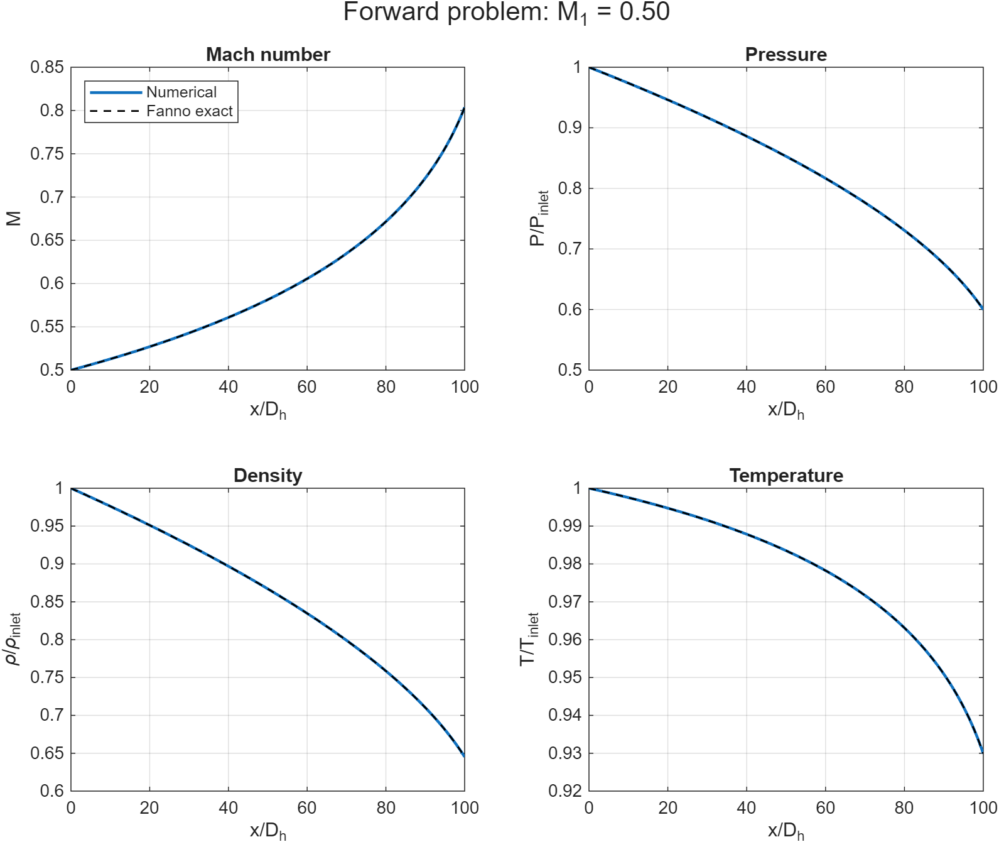
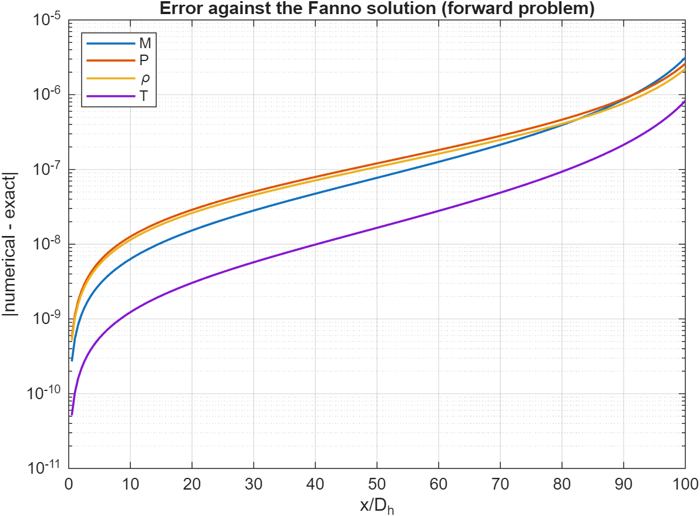
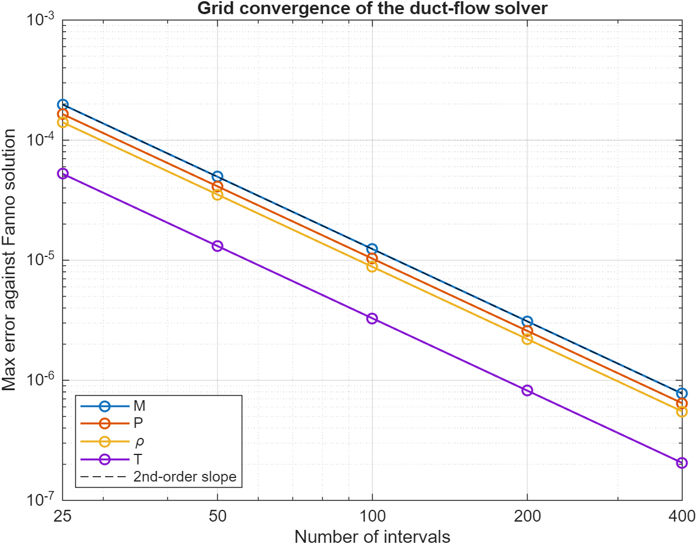
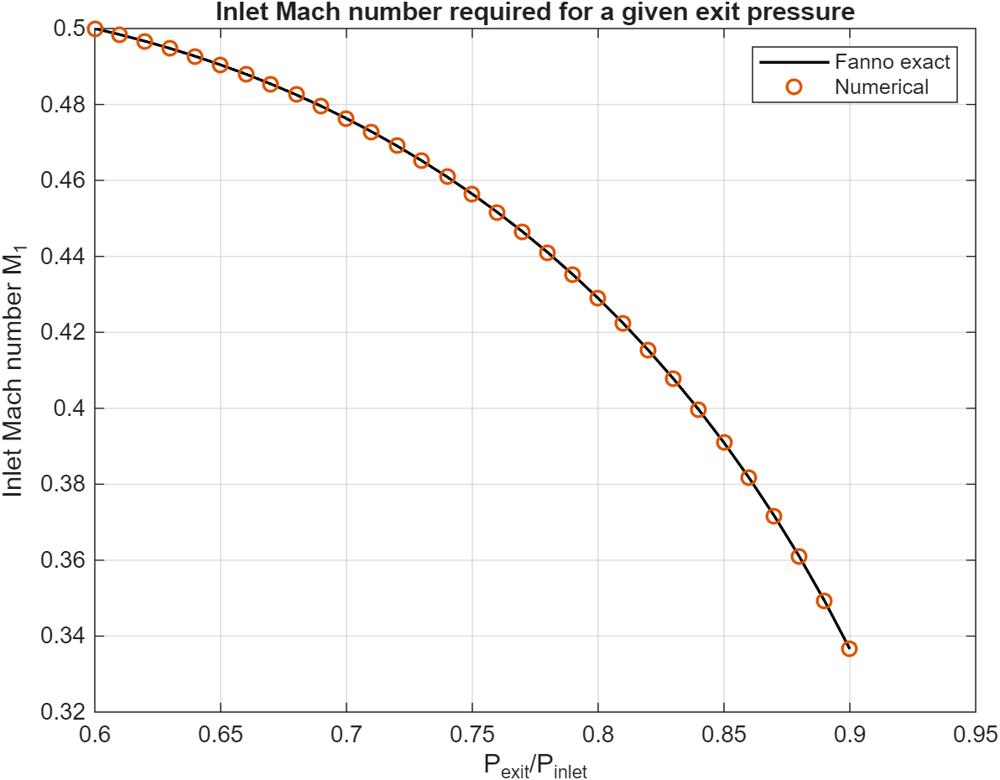

# Compressible Duct Flow with Friction: Newton Solver Validated Against Fanno Flow

A MATLAB solver for steady, adiabatic, quasi-1D flow of an ideal gas in a constant-area duct with wall friction. The discretized conservation equations are solved with Newton's method. I solve the forward problem (prescribed inlet Mach number) and the inverse problem (prescribed exit pressure), and check the results against the analytic Fanno-flow solution, including a grid-convergence study.

## Problem

Subsonic flow enters a duct of length $`L = 100\,D_h`$ at Mach number $`M_1`$. Wall friction (Darcy friction factor $`f = 0.01`$, so $`fL/D_h = 1`$) drives the flow toward higher Mach number while pressure, density, and temperature fall. The gas is ideal with $`k = 1.4`$, and the wall is adiabatic.

- **Forward problem:** given $`M_1`$, compute the flow along the duct.
- **Inverse problem:** given the exit pressure ratio $`P_N = P_{exit}/P_{inlet}`$, find the inlet Mach number that produces it.
- **Parametric study:** solve the inverse problem for $`P_N = 0.60, 0.61, \dots, 0.90`$.

## Model

Pressure, density, and temperature are normalized by their inlet values, and position by the hydraulic diameter $`D_h`$. The governing equations are:

- **Continuity:** $`\rho u`$ is constant along the duct
- **Momentum:** pressure change balances the change in momentum and wall friction
- **Energy:** stagnation temperature is constant, $`T\left(1 + \tfrac{k-1}{2}M^2\right) = \text{const}`$
- **State:** $`P = \rho T`$ in the normalized variables

## Method

**Discretization.** The duct is divided into $`N`$ equally spaced nodes. Unknowns $`M, P, \rho, T`$ at nodes $`2, \dots, N`$ (the inlet node is fixed) give $`4(N-1)`$ equations: continuity, energy, and the gas law at each node, and a momentum equation on each interval. Because $`\rho u = G`$ is constant, the momentum equation on interval $`i`$ becomes

```math
P_i - P_{i+1} = G\,(u_{i+1} - u_i) + \frac{f\,\Delta x}{4D_h}\,G\,(u_i + u_{i+1})
```

with the friction term evaluated by the trapezoidal rule.

**Solver.** Newton's method with a finite-difference Jacobian and a ramp initial guess. Iteration stops when the largest change in any unknown falls below $`10^{-10}`$.

**Inverse problem.** Newton iteration on the inlet Mach number $`M_1`$ for $`P_N(M_1) - P_{target} = 0`$, with the derivative taken by finite difference between two flow solves. Each solve starts from the previous solution, and the parametric study reuses each converged $`M_1`$ as the next starting point. The iteration stops if it leaves the unchoked range.

## Analytic reference: Fanno flow

For adiabatic flow with friction in a constant-area duct, the Mach number at a distance $`x`$ from the inlet satisfies

```math
\frac{f\,L^*}{D_h} = \frac{1-M^2}{kM^2} + \frac{k+1}{2k}\ln\frac{(k+1)M^2}{2 + (k-1)M^2}
```

where $`L^*`$ is the length of duct needed to bring the flow from Mach $`M`$ to $`M = 1`$. At each $`x`$, $`M`$ is found from $`fL^*/D_h|_{M(x)} = fL^*/D_h|_{M_1} - f\,x/D_h`$. Pressure, density, and temperature then follow from the standard Fanno ratios relative to the sonic state and are re-normalized by the inlet values. This solution is independent of the discretization, which makes it a true check on the numerical solver.

For $`fL/D_h = 1`$, the same relation gives the choking limit analytically: the largest inlet Mach number the duct can pass is $`M_1 = 0.5087`$, and the lowest reachable exit pressure ratio (choked exit) is $`0.4763`$.

## Results

### Forward problem ($`M_1 = 0.5`$, $`N = 200`$)

<p align="center">
  
</p>

Newton converged in 5 iterations (final residual $`4\times10^{-16}`$).

| Exit value | Numerical | Fanno exact |
|---|---|---|
| Mach number | 0.803687 | 0.803684 |
| P / P_inlet | 0.599923 | 0.599926 |
| rho / rho_inlet | 0.645164 | 0.645167 |
| T / T_inlet | 0.929876 | 0.929877 |

Maximum error over the duct: Mach number 3.13e-6, pressure 2.60e-6, density 2.23e-6, temperature 8.29e-7.

<p align="center">
  
</p>

### Grid convergence ($`M_1 = 0.5`$)

Maximum error against the Fanno solution, with $`N = `$ intervals $`+ 1`$ grid points:

| Intervals | Mach number | Pressure | Density | Temperature |
|---|---|---|---|---|
| 25 | 1.980e-4 | 1.647e-4 | 1.408e-4 | 5.243e-5 |
| 50 | 4.956e-5 | 4.123e-5 | 3.523e-5 | 1.312e-5 |
| 100 | 1.239e-5 | 1.031e-5 | 8.811e-6 | 3.281e-6 |
| 200 | 3.099e-6 | 2.578e-6 | 2.203e-6 | 8.204e-7 |
| 400 | 7.747e-7 | 6.445e-7 | 5.508e-7 | 2.051e-7 |

The observed order, $`\log_2(E_h / E_{h/2})`$, is 2.00 for every variable between every pair of successive grids.

<p align="center">
  
</p>

### Inverse problem ($`P_N = 0.60`$)

Converged in 3 iterations. The inlet Mach number is **0.499988** (Fanno exact: 0.499989), and the exit pressure ratio of the converged solution matches the target to the precision printed (0.60000000).

### Parametric study ($`P_N = 0.60`$ to $`0.90`$)

<p align="center">
  
</p>

| Exit pressure ratio | Inlet Mach (numerical) | Inlet Mach (Fanno exact) | Absolute error |
|---|---|---|---|
| 0.60 | 0.49999 | 0.49999 | 3.9e-7 |
| 0.65 | 0.49043 | 0.49043 | 2.4e-7 |
| 0.70 | 0.4763 | 0.4763 | 1.5e-7 |
| 0.75 | 0.45642 | 0.45642 | 9.3e-8 |
| 0.80 | 0.42897 | 0.42897 | 5.3e-8 |
| 0.85 | 0.39094 | 0.39094 | 2.6e-8 |
| 0.90 | 0.3366 | 0.3366 | 1.0e-8 |

Values are shown as printed by MATLAB; all 31 cases are in `results/duct_parametric_study.csv`.

## Findings

- **The solver agrees with the exact solution to within a few parts per million.** At $`N = 200`$ the largest error anywhere in the duct is $`3\times10^{-6}`$ (Mach number), and the numerical profiles are indistinguishable from the Fanno curves.
- **The solver is second-order accurate.** Errors fall by a factor of 4.0 each time the grid is halved, for all four variables over a 16-fold range of grid spacing. This is consistent with the discretization: continuity, energy, and the gas law are applied exactly at the nodes, and in the momentum equation only the friction term is approximated (by the trapezoidal rule).
- **The case $`M_1 = 0.5`$ is close to choking.** The choking limit for this duct is $`M_1 = 0.5087`$, about 2% above the forward-problem inlet Mach number, and the flow reaches $`M = 0.80`$ at the exit.
- **The exit pressure is very sensitive to $`M_1`$ near choking.** Raising $`P_N`$ from 0.60 to 0.61 changes the required $`M_1`$ by only 0.0016, whereas raising it from 0.89 to 0.90 changes it by 0.0126. Raising $`P_N`$ lowers the required $`M_1`$ because a smaller pressure drop needs less flow.
- **The inverse problem recovers the inlet Mach number to 4e-7 or better** across the whole range, with the error largest near $`P_N = 0.60`$ and smallest near $`0.90`$.
- **The offset $`M_1 = 0.499988`$ (not exactly 0.5) is not a solver error.** The exact Fanno solution gives $`P_N = 0.599926`$ for $`M_1 = 0.5`$, so the exact inlet Mach number for $`P_N = 0.6`$ is slightly lower, 0.499989. The inverse problem is also not an independent check of the forward problem. It solves the same equations in reverse, so the Fanno comparison is what validates both.

## Limitations

- The validation compares the solver with an analytic solution that uses the same model: constant Darcy friction factor, adiabatic walls, ideal gas with $`k = 1.4`$, and subsonic flow. It shows the discretization and implementation are correct, not how well this model matches a real duct.
- One parameter set ($`k = 1.4`$, $`fL/D_h = 1`$) was studied. The choking limit and sensitivity results depend on it.
- The solver covers unchoked subsonic flow only (no choked exit, supersonic branch, or shocks). Exit pressure ratios below 0.4763 are unreachable for this duct, and the inverse problem stops with an error if the iteration leaves the unchoked range.
- The Jacobian is dense and built by finite differences. This is fine for the grids used here ($`N \le 401`$) but would be slow for much larger problems.
- Errors are measured at the grid nodes.

## How to run

Requires MATLAB R2020a or newer. From this folder:

```matlab
run_duct_flow             % forward, backward, and parametric problems; figures and CSV to ./results
study_grid_convergence    % grid-refinement study against the Fanno solution
```

## Files

| File | Purpose |
|---|---|
| `run_duct_flow.m` | Driver: forward, inverse, and parametric problems, with Fanno comparison |
| `study_grid_convergence.m` | Grid refinement and observed order of accuracy |
| `solve_duct.m` | Solves the forward problem for a given inlet Mach number |
| `solve_inlet_mach.m` | Newton iteration on inlet Mach number for a target exit pressure |
| `duct_residual.m` | Residuals of the discretized equations |
| `duct_initial_guess.m` | Ramp initial guess for Newton's method |
| `unpack_duct_state.m` | Splits the unknown vector into profiles |
| `newton_solve.m` | Newton's method with finite-difference Jacobian |
| `fanno_parameter.m` | Fanno friction parameter $`fL^*/D_h`$ |
| `fanno_exact.m` | Analytic Fanno profiles |
| `fanno_exit_pressure_ratio.m` | Analytic exit pressure for a given inlet Mach number |
| `fanno_choke_mach.m` | Analytic choking limit |
| `plot_duct_profiles.m` | Four-panel profile plot |
